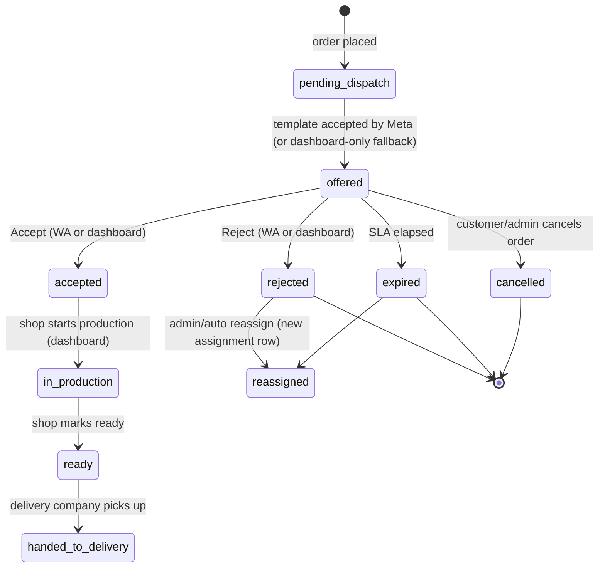
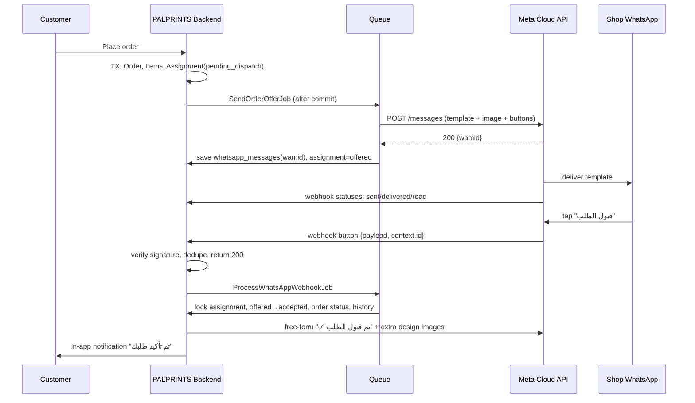

# PALPRINTS × WhatsApp Cloud API — Printing-Shop Order Integration Plan

Audience: backend developer implementing the integration in this Laravel 12 codebase.
Research date: 2026-10-02. Facts are tagged:

- **[V]** verified in Meta's official docs while preparing this plan (developers.facebook.com/documentation/business-messaging/whatsapp)
- **[K]** Meta platform behaviour I know of but did **not** re-verify from the docs this time. Confirm in the sandbox before relying on it.
- **[3P]** from third-party sources only. Confirm in Meta's UI/docs.

Meta changes limits, pricing and API versions often. Re-check every **[K]** and **[3P]** item before production.

---

## Status — 2026-10-15

The codebase moved on after this plan was written, which simplifies it:

- **Step 0 already exists.** `CheckoutService` turns the cart into an `Order` + `OrderItem`s (with `provider_cost`); the admin approves the payment notice and routes the **whole order to one branch** (`Admin\PaymentNoticeController@approve`). So there is one shop per order and the per-shop `provider_order_assignments` table is not needed: `orders.status` (`processing` → `confirmed` / `rejected` → `ready`) is the state.
- **Built on `feature/whatsapp-integration`:**
  - `config/whatsapp.php` + `WHATSAPP_*` in `.env.example` (`WHATSAPP_ENABLED=false` by default).
  - Migration: `print_providers.whatsapp_notifications_enabled`, `whatsapp_opted_in_at`; table `whatsapp_messages` (outbound + inbound log, unique wamid = webhook dedupe).
  - `PhoneNumber::normalize()` (E.164 digits, default country 970); the profile form validates and stores the normalised number and has the opt-in checkbox.
  - `ShopOrderTransitions`: accept / reject / ready, shared by the dashboard and WhatsApp.
  - `SendOrderOfferToShop` job, dispatched after commit when the admin approves the payment: template `new_print_order` with quick replies `accept:<token>` / `reject:<token>`; 4xx → failed, no retry; 5xx/429 → retried.
  - `GET|POST /webhooks/whatsapp`: verify-token handshake, `X-Hub-Signature-256` check on the raw body, monotonic delivery statuses, button taps. Reject asks for the reason by text (30 min), "إلغاء" cancels.
  - `tests/Feature/WhatsAppIntegrationTest.php`.
- **Still to do:** Meta setup (§3) and template approval (§7, body text in `config/whatsapp.php`), sandbox E2E (§22.6), reminders/expiry (§14), admin message log + resend, follow-up design images.

## 0. What the codebase looked like on 2026-10-02 (constraints on the plan)

| Fact | Consequence |
|---|---|
| **No code creates an `Order` yet.** `/checkout` is a static view; `Order::updateOrCreate` only appears in `FullDemoScenarioSeeder`. | Step 0 of the implementation is a real place-order flow (cart → `Order` + `OrderItem`). Without it nothing can trigger WhatsApp or be tested end to end. |
| Orders link to printers **per item**: `order_items.print_provider_branch_id → print_provider_branches → print_providers`. One order can span several shops. | Accept/Reject cannot live on `orders.status`. Introduce one **assignment per (order × print provider)** and accept/reject that. |
| `print_providers.whatsapp_number` (string 30, nullable) exists; validation is only `nullable|string|max:30`. | Add E.164 normalisation + validation, and an opt-in flag. |
| `order_items.provider_cost` exists. | "Printing shop earnings for this order" = `SUM(provider_cost)` of that provider's items. |
| `orders.status` is a free string (`pending, confirmed, processing, in_production, shipped, delivered, completed, cancelled`). | Keep it. Derive the order-level status from assignments. Don't rewrite the existing statuses. |
| No `app/Jobs`, `Events`, `Listeners`. Queue = `database` (jobs/failed_jobs tables exist). In-app notifications = custom `user_notifications` + `App\Support\OrderNotifier`. Print provider has no notification page. | Fallback channel = `user_notifications` + a new print-provider notifications page. |
| `printProvider/requests.blade.php` is a static mock; there is no accept/reject endpoint. | Build real dashboard accept/reject using the **same service** as the WhatsApp path. |
| Approval gate: `approval_status`, `is_active`, middleware `account.approved`. | Only send to approved + active providers. |

---

## 1. What Meta supports vs. what PALPRINTS must build

### 1.1 Supported by Meta (verified)

- **Template header = exactly one media item** (image, video or document), or text/location. **There is no multi-image template and no carousel mentioned in the template-component docs. [V]**
- Template **body ≤ 1024 chars**, footer ≤ 60. **[V]**
- **Buttons per template:** quick-reply up to 10 (25 chars each), URL up to 2 (25 chars label, URL ≤ 2000 chars, **1 variable**), phone 1, copy-code 1; max 10 total. Quick-reply buttons and other types must be grouped. With more than 3 buttons WhatsApp shows 2 and a "See all options" entry. **[V]**
- Template categories: authentication / marketing / utility. Review is automatic, "up to 24 hours". Statuses: in-review, active (quality high/medium/low), paused/disabled, rejected. Status changes arrive on the `message_template_status_update` webhook. **[V]**
- **Outside a customer-service window only approved templates can be sent.** A 24-hour window opens when the WhatsApp user messages you, and stays open while they keep messaging. Inside it you can send any non-template message (text, image, interactive). **[V]**
- Interactive **reply buttons**: up to 3, title ≤ 20 chars, id ≤ 256 chars, header can be text/image/video/document, body ≤ 1024. **[V]** These are non-template messages, so they need an open window. **[V]** (non-template messages require the window)
- Media can be sent by **uploaded media ID** or by **link** (link content is cached ~10 min; append a random query string to avoid reuse). Image messages carry **one image + optional caption**. **[V]**
- Inbound webhook for a tapped **template quick-reply** is `type: "button"` with `button.payload`, `button.text` and `context.id` (the wamid of *our* template message). **[V]**
- Inbound for **interactive** replies: `interactive.button_reply{id,title}` / `list_reply{id,title,description}` plus `context.id`. **[V]**
- Outbound status webhooks: up to three per message (sent, delivered, read). **[V]** The send API response contains the message id that later appears in these webhooks. **[V]**
- Webhook verification: GET handshake with `hub.mode`, `hub.verify_token`, `hub.challenge`; POSTs signed with `X-Hub-Signature-256` (HMAC-SHA256 of the raw body using the **app secret**). Failed deliveries are retried immediately, then a few more times with decreasing frequency for **up to 7 days**; payloads can be batched up to 1000 updates; valid (non-self-signed) TLS required; mTLS optional. **[V]**
- Webhook subscription is configured in App Dashboard or via the subscriptions API with object `whatsapp_business_account`. **[V]**
- Tokens: use a **System User** token (long-lived) with `business_management`, `whatsapp_business_management`, `whatsapp_business_messaging`. Temporary dashboard tokens expire quickly. **[V]** (24 h expiry for test tokens is **[3P]**)
- A **test business phone number** is generated and registered automatically in the getting-started flow. **[V]** Allow-list of **max 5 recipient numbers** that can't be changed/deleted after being added: **[3P]**, confirm in the API Setup screen.
- Production number must **not** be registered on the consumer WhatsApp app (delete it first); verification by SMS/voice; display name required; **two-step-verification PIN** required. **[V]** New business portfolios start with a cap of 2 registered numbers. **[V]**
- Messaging limit = max **unique recipient numbers** you can message *outside a window* per rolling 24 h. Unverified businesses ~250 (Meta text also mentions 50 right after sign-up); raise via business verification or 2000 delivered template messages to unique users in 30 days with high quality. **[V]** For PALPRINTS the unit is *printing shops*, not orders, so this is a non-issue at your scale.
- Pricing: per-message since 2025-07-01; billed when a template is **delivered**; marketing always charged; utility charged outside a window, free inside one (per Meta's pricing page). **[V]** ⚠ Third-party sources claim that from **2026-10-01** utility templates inside a window and service replies are charged too. **[3P]** The pricing page I fetched did not show that. **Check the current rate card in WhatsApp Manager before budgeting.** Our first message to a shop is business-initiated (outside a window), so it is a charged utility template either way.

### 1.2 What Meta does NOT give you → closest production-safe alternative

| You asked for | Meta reality | What we do |
|---|---|---|
| Several product + design images in the first message | One media item per template header; one image per image message; non-template messages need an open window | **Template header = ONE composite preview image** (product with design applied, rendered server-side). All other images are sent as **follow-up image messages after the shop's first tap** (the tap opens the window) and always available in the dashboard link. |
| Accept/Reject buttons + image + long details in one message | Possible *as a template*: image header + body + quick-reply buttons + URL button | Use that. Interactive reply-button messages are not needed for the first message. |
| Collect a rejection **reason** in one tap | Template quick-reply buttons carry no text input | **Two-step:** Reject tap commits the rejection, then a free-form **list message** asks the reason (see §22). Free text only for "other". |
| Buttons that become disabled after use | Not a Meta feature **[K]** | Treat every button as tappable repeatedly. Idempotency is mandatory (§17). |
| WhatsApp as source of truth | Delivery/read receipts are best-effort | The DB is the source of truth; WhatsApp is a notification/input channel. A parallel dashboard accept/reject exists. |
| Sending free-form text/images to a shop that never replied | Window closed | Use only templates until the shop interacts; otherwise fall back to dashboard/email notifications. |

---

## 2. End-to-end architecture

```
Customer places order
   └─► PALPRINTS Backend (DB tx): Order + OrderItems, build ProviderOrderAssignment per provider (status=pending_dispatch)
         └─► after-commit: dispatch SendOrderOfferJob (queue "whatsapp")
               └─► WhatsAppClient → Meta Graph API  POST /{PHONE_NUMBER_ID}/messages (template)
                     └─► Meta → Printing shop's WhatsApp  [image + details + Accept | Reject | View order]
                           ├─ shop taps Accept / Reject
                           └─► Meta → POST https://api.palprints.../webhooks/whatsapp (signed)
                                 └─► controller: verify signature, store raw event, return 200, dispatch ProcessWhatsAppWebhookJob
                                       └─► InteractionHandler → OrderAssignmentService (state machine, row lock, idempotent)
                                             ├─ update assignment + order status + history
                                             ├─ notify customer/admin (existing OrderNotifier/user_notifications)
                                             └─ confirmation / reason-prompt / extra-images via free-form messages (window now open)
```

Responsibilities:

- **Meta:** delivery to the shop's WhatsApp, template review, interactive UI, webhook calls, delivery receipts, billing.
- **PALPRINTS:** deciding who gets the order, building template parameters, queueing/retrying, webhook auth and dedup, mapping a tap to an assignment, state transitions, SLAs/expiry, fallbacks, audit trail.

---

## 3. Meta Business & WhatsApp Cloud API setup (1, 2, 3)

1. **Meta Business portfolio** (business.facebook.com) for PALPRINTS. Admins = at least two people.
2. **Developer app:** developers.facebook.com → Create App → type **Business** → add the **WhatsApp** product. Linking creates a **WABA** (WhatsApp Business Account) with an auto-provisioned **test number**. **[V]**
3. **API Setup screen** gives you the **Phone Number ID** and **WABA ID** for the test number. Add up to 5 recipient numbers (your own phones, each verified via a code). **[3P]**
4. **System User + permanent token:** Business Settings → Users → System Users → Add (Admin) → Add Assets (the app *and* the WABA, full control) → Generate token for the app with **no expiry** and permissions `business_management`, `whatsapp_business_management`, `whatsapp_business_messaging`. **[V]** (the "no expiry" option is **[K]**) Store only in `.env`/secret manager, never in the repo.
5. **Webhook:** App Dashboard → WhatsApp → Configuration → Callback URL `https://<domain>/webhooks/whatsapp`, Verify token = value of `WHATSAPP_VERIFY_TOKEN`. Subscribe fields **`messages`** (inbound + statuses) and **`message_template_status_update`**; optionally `message_template_quality_update`, `phone_number_quality_update`, `account_update`. Also subscribe the app to the WABA (`POST /{WABA_ID}/subscribed_apps`) **[K]**. In dev expose localhost with a tunnel that has a valid TLS cert (ngrok/Cloudflare Tunnel).
6. **Templates** are created in WhatsApp Manager or via `POST /{WABA_ID}/message_templates` (§7).
7. **Production number (later):** a **new SIM/number not registered on WhatsApp/WhatsApp Business app**, verify by SMS/voice, set display name (reviewed by Meta), set the two-step PIN **[V]**, add a payment method to the WABA **[K]**, then **Business Verification** (needed to scale limits / be allowed more) **[V]**. Re-subscribe the webhook for the production WABA if it differs from the test WABA.

## 4. Phone numbers: testing vs production (4)

- Store `print_providers.whatsapp_number` normalised to **E.164 digits without `+`** (e.g. `970599123456`), because the Cloud API `to` field and `wa_id` use that form. Normalisation rules: strip spaces/dashes/`+`/`00`; local `05x…` → `9705x…` (West Bank/Gaza) or `9725x…` (Israeli SIM) — **ask the business which prefix to default to; do not guess per shop**; reject anything not matching `^[1-9]\d{7,14}$`.
- Always store the `wa_id` Meta returns in the send response (`contacts[0].wa_id`) — it can differ from what you sent. Match inbound `from` against **that** value.
- **Test mode:** `WHATSAPP_TEST_MODE=true` ⇒ every outbound is redirected to `WHATSAPP_TEST_RECIPIENTS` (your allow-listed phones) regardless of the shop, with a visible `[TEST → shop #12]` prefix in a body variable. Seeded shops (`+970599000001`, `+970599222222`) must never be messaged. In test mode inbound taps map via `context.id`/payload only (not by phone), because all test shops share your phones.
- **Production:** test mode off; recipients are real shops; each shop must have given **opt-in** (checkbox in the profile + timestamp). Without opt-in do not send.

## 5. Credentials / IDs / environment variables (5, 6)

| Value | Where from | Env var |
|---|---|---|
| Phone Number ID | API Setup / WhatsApp Manager → Phone numbers | `WHATSAPP_PHONE_NUMBER_ID` |
| WABA ID | same | `WHATSAPP_WABA_ID` |
| System-user access token | Business Settings | `WHATSAPP_ACCESS_TOKEN` |
| App Secret | App Dashboard → Settings → Basic | `WHATSAPP_APP_SECRET` (signature check) |
| Verify token | you invent a long random string | `WHATSAPP_VERIFY_TOKEN` |

```dotenv
WHATSAPP_ENABLED=true
WHATSAPP_GRAPH_URL=https://graph.facebook.com
WHATSAPP_API_VERSION=vXX.X          # pin to the current version from Meta's changelog; don't copy a stale one
WHATSAPP_PHONE_NUMBER_ID=
WHATSAPP_WABA_ID=
WHATSAPP_ACCESS_TOKEN=
WHATSAPP_APP_SECRET=
WHATSAPP_VERIFY_TOKEN=
WHATSAPP_TEMPLATE_NEW_ORDER=new_print_order_v1
WHATSAPP_TEMPLATE_REMINDER=print_order_reminder_v1
WHATSAPP_TEMPLATE_LANG=ar
WHATSAPP_TEST_MODE=true
WHATSAPP_TEST_RECIPIENTS=970599xxxxxx,970598xxxxxx
WHATSAPP_ACCEPT_SLA_MINUTES=30      # business decision
WHATSAPP_REMINDER_AFTER_MINUTES=15
WHATSAPP_REJECT_GRACE_SECONDS=120
QUEUE_CONNECTION=redis              # production; "database" is fine for dev
```

`config/services.php`:

```php
'whatsapp' => [
    'enabled' => env('WHATSAPP_ENABLED', false),
    'graph_url' => env('WHATSAPP_GRAPH_URL', 'https://graph.facebook.com'),
    'version' => env('WHATSAPP_API_VERSION'),
    'phone_number_id' => env('WHATSAPP_PHONE_NUMBER_ID'),
    'waba_id' => env('WHATSAPP_WABA_ID'),
    'token' => env('WHATSAPP_ACCESS_TOKEN'),
    'app_secret' => env('WHATSAPP_APP_SECRET'),
    'verify_token' => env('WHATSAPP_VERIFY_TOKEN'),
    'test_mode' => env('WHATSAPP_TEST_MODE', true),
    'test_recipients' => array_filter(explode(',', env('WHATSAPP_TEST_RECIPIENTS', ''))),
    'templates' => ['new_order' => env('WHATSAPP_TEMPLATE_NEW_ORDER'), 'reminder' => env('WHATSAPP_TEMPLATE_REMINDER'), 'lang' => env('WHATSAPP_TEMPLATE_LANG', 'ar')],
],
```

Common failures: wrong Phone Number ID vs WABA ID (they are different objects); token without the `whatsapp_business_messaging` permission; token tied to a user instead of a system user (expires); app secret from the wrong app → every webhook rejected.

## 6. What goes in the message and what does not

Include: order number, product name/type, quantity, sizes/colours, printing areas, required production/delivery date, **this shop's** earnings, one preview image, Accept / Reject, dashboard link.
**Do not include customer name, phone or address** — WhatsApp messages sit on shop staff's personal phones. Customer shipping data stays in the dashboard behind login.

## 7. Template design & approval (7, 8)

**`new_print_order_v1`** — language `ar`, category **UTILITY** (it is a transactional notice about an order the shop is already part of; if Meta recategorises it as marketing, edit wording to be strictly transactional and resubmit — recategorisation behaviour is **[K]**).

| Component | Content |
|---|---|
| HEADER (IMAGE) | composite preview (product + design). Example image handle required at creation. |
| BODY (≤1024 incl. expanded variables) | see below |
| FOOTER | `PalPrints` |
| BUTTON 0 QUICK_REPLY | `قبول الطلب` |
| BUTTON 1 QUICK_REPLY | `رفض الطلب` |
| BUTTON 2 URL | `عرض الطلب` → `https://palprints.example/w/{{1}}` |

Body text (positional variables):

```
طلب طباعة جديد 🖨️

رقم الطلب: {{1}}
المنتج: {{2}}
الكمية: {{3}}
المقاسات والألوان: {{4}}
مناطق الطباعة: {{5}}
موعد التسليم المطلوب: {{6}}
مستحقاتكم عن الطلب: {{7}}

يرجى القبول أو الرفض خلال {{8}}.
```

Rules to respect (the first two are **[K]** — Meta rejects/ errors on them; verify at creation time):
- A variable should not be the first or last thing in the body (hence the fixed text around them).
- Variable *values* must be single-line (no `\n`, `\t`, long runs of spaces). Join multi-item specs with ` | `.
- Keep fixed-text/variable ratio reasonable; don't make a template that is mostly variables.
- Budget the 1024 chars **after expansion**: truncate `{{4}}`/`{{5}}` (e.g. 250 chars each) and end with "… التفاصيل الكاملة في لوحة التحكم".

Create-template request (shape per Meta's template API **[K]**; validate against the live API error messages):

```http
POST /{WABA_ID}/message_templates
{
  "name": "new_print_order_v1",
  "language": "ar",
  "category": "UTILITY",
  "components": [
    {"type":"HEADER","format":"IMAGE","example":{"header_handle":["<uploaded_handle>"]}},
    {"type":"BODY","text":"طلب طباعة جديد ... {{1}} ...","example":{"body_text":[["PP-10234","تيشيرت قطن - طباعة DTF","20","M×10 | L×10 | أسود","أمامي + ظهر","2026-10-15","350 ₪","30 دقيقة"]]}},
    {"type":"FOOTER","text":"PalPrints"},
    {"type":"BUTTONS","buttons":[
      {"type":"QUICK_REPLY","text":"قبول الطلب"},
      {"type":"QUICK_REPLY","text":"رفض الطلب"},
      {"type":"URL","text":"عرض الطلب","url":"https://palprints.example/w/{{1}}","example":["abc123"]}
    ]}
  ]
}
```

Also create `print_order_reminder_v1` (no media, one body + same 3 buttons or only the URL button) for the SLA reminder (§21). Version templates (`_v2`) instead of editing live ones; keep the template name in config.

**Sending images beyond the header (the multi-image answer):**
1. First message (template) = one composite preview.
2. When the shop taps *any* button, an inbound message arrives → the 24 h window is open **[V: window opens on user message; that a button tap counts is [K] — confirm in sandbox, it is the pivot of this design]**.
3. Then, as free-form messages: one `image` message per design/area (caption "المنطقة: أمامي"), cap at ~5, in a queued job, upload media once (`POST /{PHONE_NUMBER_ID}/media`) and reuse the media ID. Image formats/size limits: JPEG/PNG, small enough (Meta's media limits apply — check the media page, I did not verify numbers).
4. Everything is always in the dashboard.

Send payload (per Meta's template send reference **[K]**):

```json
POST /{PHONE_NUMBER_ID}/messages
{
  "messaging_product": "whatsapp",
  "to": "970599123456",
  "type": "template",
  "template": {
    "name": "new_print_order_v1",
    "language": {"code": "ar"},
    "components": [
      {"type":"header","parameters":[{"type":"image","image":{"id":"<media_id>"}}]},
      {"type":"body","parameters":[
        {"type":"text","text":"PP-10234"}, {"type":"text","text":"تيشيرت قطن - طباعة DTF"},
        {"type":"text","text":"20"}, {"type":"text","text":"M×10 | L×10 | أسود"},
        {"type":"text","text":"أمامي + ظهر"}, {"type":"text","text":"2026-10-15"},
        {"type":"text","text":"350 ₪"}, {"type":"text","text":"30 دقيقة"}]},
      {"type":"button","sub_type":"quick_reply","index":"0","parameters":[{"type":"payload","payload":"acc:01JABCDEF..."}]},
      {"type":"button","sub_type":"quick_reply","index":"1","parameters":[{"type":"payload","payload":"rej:01JABCDEF..."}]},
      {"type":"button","sub_type":"url","index":"2","parameters":[{"type":"text","text":"Xk3Yq9..."}]}
    ]
  }
}
```

Response (typical shape; the message id is **[V]**):

```json
{"messaging_product":"whatsapp","contacts":[{"input":"970599123456","wa_id":"970599123456"}],"messages":[{"id":"wamid.HBgL...","message_status":"accepted"}]}
```

Failure cases: `132000` parameter count mismatch, `132001` template/language not found or not approved, `132012` parameter format mismatch, `131047` outside window (free-form), `131026` undeliverable (not on WhatsApp / not allow-listed in test), `130429` throughput/rate limit, `131056` pair rate limit, `190` invalid/expired token. **[K]** — codes from memory; verify against Meta's error-code page and log the raw `error` object always.

## 8. Accept / Reject interaction design (9)

- Quick-reply `payload` strings (set at send time, per message): `acc:<assignment_token>` and `rej:<assignment_token>`. `assignment_token` is an opaque ULID/random 20+ chars stored on the assignment row. Do **not** put raw order IDs or anything guessable. Payload length limit is **[K]** ~128 chars; our payload is ~30.
- On inbound `type=button`: parse `button.payload` → verb + token. Authenticate the tap with **three** independent checks, all must pass:
  1. `messages[0].context.id` equals a `wa_message_id` we sent for that assignment (`whatsapp_messages.wa_message_id`),
  2. token matches that assignment,
  3. `from` (wa_id) equals the provider's stored `wa_id` (skipped only in test mode).
- `acc` → `OrderAssignmentService::accept()`; `rej` → `reject()` then reason prompt (§22).
- Inbound text/other types from shops: log, and if inside the window reply once with an auto-message: "للرد استخدم الأزرار أو افتح لوحة التحكم: <link>". Never parse free text as accept/reject.
- Confirmation back to the shop (free-form, window open): "✅ تم قبول الطلب PP-10234" / "❌ تم رفض الطلب …".

## 9. "View order on PALPRINTS" link — secure design (10)

- URL button with **one variable at the end** (Meta allows 1 variable, URL ≤ 2000 chars **[V]**): `https://palprints.example/w/{{1}}`.
- `{{1}}` = random 32-byte URL-safe `deep_link_token`, stored **hashed (sha256)** on the assignment with `expires_at` (e.g. 7 days) — different from the quick-reply token.
- `GET /w/{token}`: look up hash → if valid redirect to `/print-provider/orders/{id}` **but only after normal login** (store intended URL; use Laravel's `redirect()->guest`). After login, authorise with a Policy: `auth user → printProvider->id === assignment->print_provider_id`. The token never authenticates anyone; it only locates the order. Unknown/expired token ⇒ generic 404 (no enumeration), rate-limited route.
- No PII, no order number, no sequential ids in the URL. Add `Referrer-Policy: no-referrer`.

## 10. Webhook setup, verification, payload handling (11, 12)

Route (outside `web` auth/CSRF; Laravel 12 `bootstrap/app.php`):

```php
->withMiddleware(function (Middleware $m) {
    $m->validateCsrfTokens(except: ['webhooks/whatsapp']);
})
```

```php
Route::get('/webhooks/whatsapp',  [WhatsAppWebhookController::class, 'verify']);
Route::post('/webhooks/whatsapp', [WhatsAppWebhookController::class, 'receive'])->middleware('throttle:600,1');
```

- **GET verify:** if `hub.mode==='subscribe'` and `hash_equals(config verify_token, hub.verify_token)` → respond 200 with `hub.challenge` as plain text; else 403. **[V]**
- **POST receive:**
  1. Read the **raw** body (`$request->getContent()`); compute `hash_hmac('sha256', $raw, $appSecret)`; `hash_equals` against the part after `sha256=` of `X-Hub-Signature-256`; mismatch → 401 and log. **[V]**
  2. Persist raw payload into `whatsapp_webhook_events` (with `signature_valid`).
  3. Dispatch `ProcessWhatsAppWebhookJob` (queue `whatsapp-inbound`) and **return 200 immediately** (Meta retries for up to 7 days on non-2xx/timeouts, so slow handlers create duplicates). **[V]** retry behaviour
  4. A payload can batch many `entry[].changes[]` (up to 1000). Iterate all.
- Processor splits `value.messages[]` (inbound) from `value.statuses[]` (outbound receipts) and `field = message_template_status_update` (template approval).

Inbound tapped template button **[V]**:

```json
{"object":"whatsapp_business_account","entry":[{"id":"<WABA_ID>","changes":[{"field":"messages","value":{
  "messaging_product":"whatsapp",
  "metadata":{"display_phone_number":"15550783881","phone_number_id":"106540352242922"},
  "contacts":[{"profile":{"name":"Print Shop"},"wa_id":"970599123456"}],
  "messages":[{"context":{"from":"15550783881","id":"wamid.<OUR_TEMPLATE_WAMID>"},
    "from":"970599123456","id":"wamid.<INBOUND_ID>","timestamp":"1750091045",
    "type":"button","button":{"payload":"acc:01JABCDEF...","text":"قبول الطلب"}}]}}]}]}
```

Interactive reply (reason list, free-form) **[V]**:

```json
{"type":"interactive","interactive":{"type":"list_reply","list_reply":{"id":"rr:01JABCDEF:cannot_meet_date","title":"الموعد غير مناسب"}},
 "context":{"id":"wamid.<OUR_LIST_MESSAGE_WAMID>"},"id":"wamid.<INBOUND_ID>"}
```

Status event (shape **[K]**, ids/status names per Meta's docs):

```json
{"statuses":[{"id":"wamid.<OUR_WAMID>","status":"delivered","timestamp":"1750091100","recipient_id":"970599123456"}]}
{"statuses":[{"id":"wamid.<OUR_WAMID>","status":"failed","timestamp":"...","recipient_id":"...","errors":[{"code":131026,"title":"Message undeliverable","message":"..."}]}]}
```

## 11. Delivery status tracking (16)

- On send: create `whatsapp_messages` row (`status=queued`) → after Graph success store `wa_message_id`, `status=accepted`.
- On statuses webhook: look up by `wa_message_id`; apply **monotonic** ranking `queued < accepted < sent < delivered < read` (events can arrive out of order/duplicated); `failed` is terminal and records `error_code/error_message`. Set the matching `*_at` timestamp.
- `read` is informational only; never treat read as acceptance.
- If an assignment's offer message goes `failed` → trigger fallback (§13).

## 12. Idempotency & duplicate taps (17)

Layers, all required:
1. **Event dedupe:** unique index on `whatsapp_webhook_events.event_key` (= inbound `messages[].id` or `statuses[].id + status`). Duplicate insert ⇒ ignore.
2. **Inbound message dedupe:** unique `whatsapp_messages.wa_message_id` (direction=in).
3. **State-machine guard:** in one DB transaction with `lockForUpdate()` on the assignment: only `offered → accepted|rejected` is allowed. Conditional update `UPDATE … SET status=? WHERE id=? AND status='offered'`; affected rows = 0 ⇒ already handled.
4. **Same-outcome repeat:** shop taps Accept twice ⇒ second is a no-op, reply "الطلب مقبول مسبقاً".
5. **Conflicting taps:** Accept after Reject (or after expiry/reassignment/customer cancel) ⇒ no state change, reply "هذا الطلب لم يعد متاحاً" (and for reject→accept within the grace window see §22). Buttons remain tappable forever **[K]**, so this path will be exercised.
6. **Dashboard/WhatsApp race:** both go through `OrderAssignmentService`, so the guard above resolves it.
7. **Send idempotency:** `SendOrderOfferJob` implements `ShouldBeUnique` on `assignment_id`, and checks no `whatsapp_messages` row with `purpose=offer, status in (accepted,sent,delivered,read)` exists before sending (a retry after a timeout must not double-send).

## 13. Queue / job architecture (15) and failure handling (19, 20)

Queues: `whatsapp` (outbound), `whatsapp-inbound` (webhook processing), `default`. Production: Redis + Horizon (or Supervisor `queue:work --queue=whatsapp-inbound,whatsapp,default`). Current `database` driver works for development.

| Job | Trigger | Notes |
|---|---|---|
| `SendOrderOfferJob(assignmentId)` | after-commit when order placed | builds params, uploads/reuses preview media, sends template, writes `whatsapp_messages`. `tries=5`, backoff `[30,120,600,1800]`. Retry only on 5xx/429/network; **never** retry on 4xx validation errors (132xxx, 131026) — fail fast to fallback. |
| `SendWhatsAppMessageJob` | generic free-form send (confirmations, reason prompt, extra images) | checks window is open (last inbound from that wa_id < 24 h) before sending; otherwise skip/log. |
| `ProcessWhatsAppWebhookJob(eventId)` | webhook receive | idempotent; marks event `processed_at`; exceptions ⇒ retry, then `failed_jobs`. |
| `SendRejectionReasonPromptJob` | after reject | list message. |
| `SendDesignImagesJob` | after first tap | follow-up images, ≤5. |
| `SendAssignmentReminderJob` | scheduled | reminder template at T+`REMINDER_AFTER`. |
| `ExpireStaleAssignmentsCommand` (scheduler, every minute) | `routes/console.php` | `offered` and `expires_at < now` ⇒ `expired` ⇒ reassign/escalate. |
| `ReassignOrJobEscalate` | on reject/expire/delivery-failed | see below. |
| `SyncTemplateStatus` | `message_template_status_update` webhook | alert devs when `new_print_order_v1` is paused/disabled/rejected. |

**If WhatsApp delivery fails** (token invalid, 131026, template disabled, retries exhausted, or `failed` status):
1. Mark `whatsapp_messages.status=failed`, keep the raw error.
2. Create the in-app notification for the shop (`user_notifications`, link to the order) and send an email to `contact_email` (needs a mailer; `MAIL_MAILER=log` is dev-only).
3. Keep the assignment `offered` (the shop can still accept in the dashboard) but flag `whatsapp_delivery_failed=true` so admin sees it.
4. Alert admins (notification) if the failure is systemic (token/template problems ⇒ many failures in a short window).
5. The offer expiry timer keeps running — an order is never stuck because WhatsApp failed.

## 14. Shop doesn't respond (21)

- `offered_at` + `SLA` ⇒ `expires_at`. T+15 min: reminder template (utility; free-form is not allowed outside a window). T+30 min: `expired` ⇒ `reassign`.
- **Reassignment is a business decision that the current data model does not support yet**: items are bound to a branch via `branch_product_offering_id` chosen by the customer. Options: (a) escalate to admin who reassigns manually (recommended v1), (b) auto-pick another provider who has the same product offering. Decide before building.
- Customer-facing: after expiry/rejection with no replacement, order shows "قيد المراجعة" and the customer is notified (existing `OrderNotifier`).

## 15. Rejection reason UX (22)

Recommended: **commit the rejection first, ask the reason second, and make the reason optional.**

1. Reject tap ⇒ assignment `rejected` (after an optional short grace, below) ⇒ reassignment/escalation starts immediately so the customer's SLA isn't blocked on a form.
2. Bot sends (free-form, window is open) an **interactive list** message "ما سبب الرفض؟" with rows:
   `capacity_full` (ضغط على العمل), `material_unavailable` (المادة غير متوفرة), `cannot_meet_date` (الموعد غير مناسب), `price_too_low` (السعر غير مناسب), `design_file_issue` (مشكلة بملف التصميم), `other` (سبب آخر). Row `id` = `rr:<assignment_token>:<code>`. (List limits — rows ≤10, title ≤24 chars, button label ≤20 — are **[K]**; I verified only reply-button limits.)
3. `list_reply` ⇒ store `rejection_reason_code`. For `other` ⇒ send "اكتب السبب برسالة نصية" and bind the **next inbound text from that wa_id within 24 h** to that assignment (`whatsapp_conversation_state` or a `awaiting_reason_for_assignment_id` column on the provider contact row).
4. No reply ⇒ `rejection_reason_code=not_provided`. Admin sees it.
5. **Accidental taps:** one-tap buttons are easy to mis-hit. Optional grace: after Reject, send "تم الرفض. للتراجع خلال دقيقتين اضغط تراجع" (interactive reply button `undo:<token>`). Delay reassignment by `REJECT_GRACE_SECONDS`; undo restores `offered` only if not yet reassigned. Skip in v1 if you want less moving parts.
6. Alternative (phase 2): a **WhatsApp Flow** attached to the template with a FLOW button gives a real form (dropdown + text) in one step; results arrive as `nfm_reply.response_json`. Meta supports template FLOW buttons and Flow endpoints **[V: flow button exists]**, but needs Flow JSON, optionally an encrypted endpoint, and extra review. Not worth it for v1.
7. The dashboard Reject button uses the same service and a required-reason modal.

## 16. State machines (23)

Assignment (one per order × provider):



Order-level `orders.status` derived (keep existing strings): all assignments accepted ⇒ `confirmed`; any `in_production` ⇒ `in_production`; any rejected/expired with no replacement ⇒ stays `pending` + `needs_attention` flag (add column `orders.needs_attention`), customer cancel allowed only from `pending` as today. Write every transition to `order_status_history` and a new `provider_assignment_events` audit row.

Guard table (only these transitions are legal; everything else is a no-op that returns the current state):

| From | Event | To |
|---|---|---|
| offered | accept | accepted |
| offered | reject | rejected |
| offered | timeout | expired |
| offered | cancel | cancelled |
| accepted | start | in_production |
| rejected (grace) | undo | offered |

## 17. Sequence diagram



## 18. Database schema (14)

```php
// print_providers (alter)
$t->string('whatsapp_wa_id', 20)->nullable();            // from Meta response
$t->boolean('whatsapp_notifications_enabled')->default(false);
$t->timestamp('whatsapp_opted_in_at')->nullable();
// whatsapp_number: normalise to E.164 digits via migration + FormRequest rule

// orders (alter)
$t->boolean('needs_attention')->default(false);

Schema::create('provider_order_assignments', function (Blueprint $t) {
    $t->id();
    $t->foreignId('order_id')->constrained()->cascadeOnDelete();
    $t->foreignId('print_provider_id')->constrained();
    $t->foreignId('print_provider_branch_id')->nullable()->constrained();
    $t->string('status', 30)->index();            // pending_dispatch, offered, accepted, rejected, expired, cancelled, in_production, ready, handed_to_delivery
    $t->string('action_token', 40)->unique();     // used in quick-reply payloads
    $t->char('deep_link_hash', 64)->nullable()->unique();
    $t->timestamp('deep_link_expires_at')->nullable();
    $t->decimal('provider_amount', 10, 2);        // SUM(order_items.provider_cost)
    $t->timestamp('offered_at')->nullable();
    $t->timestamp('expires_at')->nullable()->index();
    $t->timestamp('responded_at')->nullable();
    $t->string('responded_via', 20)->nullable();  // whatsapp | dashboard | system
    $t->string('rejection_reason_code', 40)->nullable();
    $t->text('rejection_reason_text')->nullable();
    $t->boolean('whatsapp_delivery_failed')->default(false);
    $t->foreignId('reassigned_from_id')->nullable()->constrained('provider_order_assignments');
    $t->unique(['order_id','print_provider_id','reassigned_from_id']);
    $t->timestamps();
});

Schema::create('provider_assignment_events', function (Blueprint $t) {  // audit
    $t->id(); $t->foreignId('assignment_id')->constrained()->cascadeOnDelete();
    $t->string('from_status', 30)->nullable(); $t->string('to_status', 30);
    $t->string('actor', 20); $t->string('source_ref')->nullable(); // wamid or user id
    $t->json('meta')->nullable(); $t->timestamp('created_at');
});

Schema::create('whatsapp_messages', function (Blueprint $t) {
    $t->id();
    $t->string('direction', 3);                     // out | in
    $t->foreignId('assignment_id')->nullable()->constrained('provider_order_assignments');
    $t->foreignId('print_provider_id')->nullable()->constrained();
    $t->string('purpose', 30)->nullable();          // offer, reminder, confirmation, reason_prompt, design_image, auto_reply
    $t->string('wa_id', 20)->index();
    $t->string('wa_message_id')->nullable()->unique();
    $t->string('context_wa_message_id')->nullable()->index();   // inbound: message being replied to
    $t->string('type', 20);                          // template|text|image|interactive|button|...
    $t->string('template_name')->nullable(); $t->string('template_lang', 10)->nullable();
    $t->json('payload')->nullable();                 // request body (out) / message object (in) — no secrets
    $t->string('status', 12)->default('queued');     // queued, accepted, sent, delivered, read, failed (out); received (in)
    $t->string('error_code', 20)->nullable(); $t->text('error_message')->nullable();
    $t->unsignedTinyInteger('attempts')->default(0);
    $t->timestamp('sent_at')->nullable(); $t->timestamp('delivered_at')->nullable();
    $t->timestamp('read_at')->nullable(); $t->timestamp('failed_at')->nullable();
    $t->timestamps();
});

Schema::create('whatsapp_webhook_events', function (Blueprint $t) {
    $t->id();
    $t->string('event_key')->unique();               // messages[].id or statuses[].id:status
    $t->string('kind', 20);                          // message | status | template | other
    $t->boolean('signature_valid');
    $t->json('payload');                             // raw; prune after 30–90 days
    $t->timestamp('processed_at')->nullable();
    $t->text('error')->nullable();
    $t->timestamps();
});

Schema::create('whatsapp_conversation_state', function (Blueprint $t) { // only for "other" reason free text
    $t->id(); $t->string('wa_id', 20)->unique();
    $t->foreignId('awaiting_reason_assignment_id')->nullable()->constrained('provider_order_assignments');
    $t->timestamp('expires_at')->nullable(); $t->timestamps();
});
```

## 19. Endpoints (API / webhook)

| Method & path | Purpose | Auth |
|---|---|---|
| `GET /webhooks/whatsapp` | Meta verification handshake | verify token |
| `POST /webhooks/whatsapp` | inbound events/statuses | HMAC signature |
| `GET /w/{token}` | deep link → login → order page | token locates, login authorises |
| `PATCH /print-provider/assignments/{assignment}/accept` | dashboard accept | `role:print_provider` + `account.approved` + policy |
| `PATCH /print-provider/assignments/{assignment}/reject` | dashboard reject (reason required) | same |
| `GET /print-provider/requests` (rebuild) | real list of assignments by tab | same |
| `GET /print-provider/notifications` (+ read) | missing notification page | same |
| `POST /admin/assignments/{assignment}/resend-whatsapp` | manual resend | admin |
| `POST /admin/assignments/{assignment}/reassign` | manual reassignment | admin |
| `GET /admin/whatsapp/messages` | message log + status for support | admin |

## 20. Suggested code layout

```
app/Services/WhatsApp/
  WhatsAppClient.php               # Http::withToken()->retry-free; one method per Graph call (sendTemplate, sendText, sendImage, sendInteractiveList, uploadMedia, createTemplate)
  PhoneNumberNormalizer.php
  Templates/NewOrderTemplateBuilder.php   # assignment → components array, enforces 1024-char budget, strips newlines
  Webhook/SignatureVerifier.php
  Webhook/WebhookProcessor.php            # splits messages / statuses / template updates
  Webhook/InteractionHandler.php          # button & interactive → OrderAssignmentService
  Webhook/StatusUpdater.php               # monotonic status updates
app/Services/Orders/
  PlaceOrderService.php            # step 0: cart → order + assignments
  OrderAssignmentService.php       # accept/reject/expire/undo with locking + history + events
  AssignmentLinkService.php        # deep-link token issue/resolve
app/Jobs/WhatsApp/ SendOrderOfferJob, SendWhatsAppMessageJob, ProcessWhatsAppWebhookJob, SendRejectionReasonPromptJob, SendDesignImagesJob, SendAssignmentReminderJob
app/Console/Commands/ExpireStaleAssignments.php   (scheduled in routes/console.php)
app/Http/Controllers/WhatsAppWebhookController.php
app/Http/Controllers/PrintProvider/AssignmentController.php, NotificationController.php
app/Models/ProviderOrderAssignment.php, WhatsAppMessage.php, WhatsAppWebhookEvent.php
app/Policies/ProviderOrderAssignmentPolicy.php
app/Enums/AssignmentStatus.php
```

Extend `App\Support\OrderNotifier` with `newOrderForProvider()` for the in-app fallback.

## 21. Authentication & security checklist (18)

- Signature check on **every** POST with the **raw** body and `hash_equals`; never JSON-decode first.
- `GET` verify token compare with `hash_equals`; long random value.
- HTTPS with a real certificate only. Optionally mTLS **[V: available]**.
- Webhook route excluded from CSRF and not behind `auth`; throttled.
- Tokens: system-user token in secrets, rotate on staff change, never logged. Log Graph errors but redact `Authorization`.
- Payload tokens unguessable; 3-factor tap authentication (§8).
- No customer PII in WhatsApp; no secrets in `payload` JSON columns.
- Opt-in flag + timestamp per shop; honour a "STOP"-style request: if a shop replies with opt-out text, set `whatsapp_notifications_enabled=false` and rely on dashboard/email.
- Prune `whatsapp_webhook_events.payload` after 30–90 days.
- Admin message log access limited to admins; contains shop phone numbers.

## 22. Testing strategy (24)

1. **Unit:** `PhoneNumberNormalizer`, `SignatureVerifier` (valid/invalid/tampered body), template parameter builder (1024 budget, newline stripping, Arabic text), `OrderAssignmentService` transition table including illegal transitions.
2. **Feature (Laravel `Http::fake()`):** place order ⇒ assignment + job dispatched after commit; job builds exact JSON; 4xx ⇒ no retry + fallback notification; 5xx/429 ⇒ retry with backoff; `Queue::fake()` for dispatch assertions.
3. **Webhook fixtures:** store the sample JSONs above (button, list_reply, statuses sent/delivered/read/failed, template status update); post with a correct HMAC; assert state changes and 200 response time.
4. **Idempotency:** replay the same webhook 5×; two concurrent Accept (`parallel`/DB transaction test) ⇒ exactly one transition; Accept after Reject; tap after expiry; dashboard accept racing WhatsApp reject.
5. **Out-of-order statuses:** `read` before `delivered` must not regress status.
6. **Sandbox E2E (real Meta):** test number + your own phones in the recipient list + public HTTPS tunnel; use the App Dashboard "test webhook" tool for quick checks, then real taps. Specifically confirm: (a) template approved and renders with image + 3 buttons in Arabic RTL, (b) button-tap `context.id` equals the template wamid, (c) the tap opens the window so free-form images/list messages succeed (the pivot assumption), (d) repeated taps behave as expected, (e) the URL button variable works.
7. **Failure drills:** wrong token (190), recipient not allow-listed, disabled template, tunnel down for 10 min then up (Meta retries ⇒ dedupe), 2 shops in one order.
8. **Load sanity:** 100 simultaneous orders ⇒ queue drains, no duplicate offers.

## 23. Recommended implementation order (step-by-step)

0. **Build the place-order flow** (cart → `Order`/`OrderItem`, `provider_cost`, pending status) — prerequisite.
1. Meta setup (§3): app, test number, 2–3 recipient phones, system-user token, `.env`.
2. Migrations: `provider_order_assignments`, `provider_assignment_events`, `whatsapp_messages`, `whatsapp_webhook_events`, print-provider columns; E.164 normaliser + validation + opt-in checkbox in the profile form.
3. `OrderAssignmentService` + enum + audit, with dashboard accept/reject and the real `requests` page (works with zero WhatsApp — this is the source of truth and the fallback).
4. Deep link `/w/{token}` + policy.
5. `WhatsAppClient` + config + test mode; send a hand-made template from tinker to your phone.
6. Create/approve `new_print_order_v1` (submit early; review can take up to 24 h **[V]**).
7. `NewOrderTemplateBuilder` + `SendOrderOfferJob`; hook into order placement (after commit).
8. Webhook controller + signature + event storage + processor + status tracking.
9. `InteractionHandler`: accept/reject mapping, idempotency, confirmations.
10. Rejection reason flow + follow-up design images.
11. Scheduler: reminder template, expiry, escalation to admin; admin message log + resend.
12. Fallbacks: print-provider notification page, email, systemic-failure alert.
13. Test suite (§22), sandbox E2E, then failure drills.
14. Production move (below).

## 24. Production deployment checklist (25)

- [ ] Business Verification done; display name approved; payment method on the WABA; rate card checked (pricing note in §1.1).
- [ ] Dedicated production number (not on any WhatsApp app), registered, two-step PIN stored in the secret manager.
- [ ] System-user token (no expiry) for the **production** WABA; app secret; verify token — all in secrets, rotated on staff change.
- [ ] Webhook URL on the production domain, valid TLS, subscribed fields `messages` + `message_template_status_update`, WABA subscribed to the app.
- [ ] Templates approved in production WABA (same names/language); template-status alert wired.
- [ ] `WHATSAPP_TEST_MODE=false`; every shop has a normalised number + opt-in; seeded demo shops excluded.
- [ ] Queue on Redis + Horizon/Supervisor, `whatsapp` and `whatsapp-inbound` workers, scheduler (`schedule:work`/cron) running, failed-job alerting.
- [ ] Log retention/pruning for webhook payloads; DB indexes on `wa_message_id`, `assignments.status/expires_at`.
- [ ] Monitoring: failed-send rate, webhook 401 rate, assignments stuck in `offered`, template quality rating, messaging-limit headroom.
- [ ] Runbook: token expired, template paused, number flagged/quality drop, Meta outage ⇒ dashboard-only mode (`WHATSAPP_ENABLED=false` keeps ordering working).
- [ ] SLA values (accept window, reminder, grace) agreed with the business.

---

### Open decisions for the product owner

1. Accept SLA length and what happens on expiry: manual admin reassignment (recommended v1) or automatic?
2. Default country prefix handling for local numbers (970 vs 972).
3. Keep the "undo reject" grace step in v1?
4. Confirm current Meta pricing for utility templates (the Oct-2026 change reported by third parties vs Meta's page).

### Sources (Meta official, fetched 2026-10-02)
- https://developers.facebook.com/documentation/business-messaging/whatsapp/templates/components
- https://developers.facebook.com/documentation/business-messaging/whatsapp/templates/overview
- https://developers.facebook.com/documentation/business-messaging/whatsapp/messages/send-messages
- https://developers.facebook.com/documentation/business-messaging/whatsapp/messages/interactive-reply-buttons-messages
- https://developers.facebook.com/documentation/business-messaging/whatsapp/webhooks/create-webhook-endpoint
- https://developers.facebook.com/documentation/business-messaging/whatsapp/webhooks/reference/messages
- https://developers.facebook.com/documentation/business-messaging/whatsapp/webhooks/reference/messages/button
- https://developers.facebook.com/documentation/business-messaging/whatsapp/webhooks/reference/messages/interactive
- https://developers.facebook.com/documentation/business-messaging/whatsapp/business-phone-numbers/phone-numbers
- https://developers.facebook.com/documentation/business-messaging/whatsapp/pricing
- https://developers.facebook.com/documentation/business-messaging/whatsapp/messaging-limits
- https://developers.facebook.com/documentation/business-messaging/whatsapp/access-tokens/
- https://developers.facebook.com/documentation/business-messaging/whatsapp/flows
